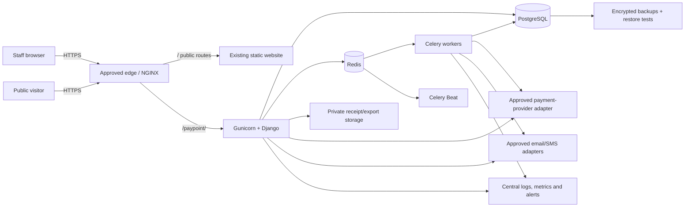
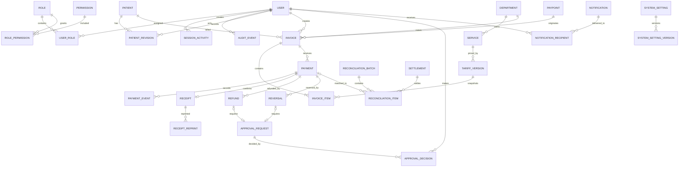

# IMSUTH PayPoint — Phase A Discovery and Architecture

**Status:** Proposed for hospital and infrastructure review  
**Scope:** Architecture only; no PayPoint application or production routing has been implemented  
**Prepared:** 10 October 2026

## 1. Executive decision

The existing IMSUTH repository is a static, JSON-driven public website deployed to cPanel. It includes two small PHP form relays but has no application server, PostgreSQL, Redis, background worker, private file store, or financial audit infrastructure. Patient and financial functions must therefore be built as an isolated Django application and must not reuse the public JSON or browser-only administration mechanisms.

The preferred production design is a dedicated application environment running Django, PostgreSQL, Redis and Celery behind NGINX. The public URL can remain `https://www.imsuth.org/paypoint/` only if either:

1. the existing host supports a secure path-level reverse proxy to the application environment; or
2. the public website and PayPoint are moved behind one approved NGINX or equivalent edge layer.

The repository does not prove that the current cPanel plan supports either option. Hosting capability, DNS, TLS, backups and operational ownership must be confirmed before implementation or routing changes.

## 2. Existing website architecture assessment

### Confirmed from the repository

| Area | Current state | PayPoint implication |
|---|---|---|
| Frontend | HTML5, CSS3 and vanilla JavaScript | Preserve unchanged; add only an approved staff login link later. |
| Content | Public JSON files under `website/data/` | Never store patients, invoices, payments or private configuration here. |
| Forms | PHP 8.1+ relays for appointment/contact webhooks | Not suitable as a financial application backend. |
| Hosting | cPanel deployment to `public_html` through `.cpanel.yml` or GitHub Actions/SSH | Current deployment publishes static/PHP assets only. |
| Web rules | Apache `.htaccess` with access controls and security headers | No `/paypoint/` proxy rule or application mount exists. |
| TLS | HTTPS is required in documentation; recent cPanel evidence showed no certificate available | Valid TLS must exist before staff access or any sensitive processing. |
| Forms mode | Development mode in `website/data/settings.json` | Public forms are not evidence of a production data-processing platform. |
| Application runtime | No Django project, Python dependency manifest, WSGI/ASGI entry point or container definition | Build as a new isolated service after approval. |
| Data services | No PostgreSQL, Redis, Celery or private object storage configuration | Must be provisioned outside the public document root. |
| CI/CD | Static validation and rsync deployment | PayPoint requires a separate gated pipeline with migrations, tests, image scanning and rollback. |

### Known limitations and risks

- cPanel shared hosting may not provide persistent Redis/Celery processes, PostgreSQL extensions, service supervision, private networking or NGINX proxy control.
- The current workflow copies files directly into the public document root and is inappropriate for secrets or private application data.
- `admin.html` is a local/static content-authoring utility, not an authenticated CMS and not a foundation for PayPoint administration.
- Exact document root, server software/version, current DNS authority, SSL provider/status, backups and SSH limitations require host confirmation.
- The repository has unrelated uncommitted public-site work. PayPoint work should begin on an approved branch without overwriting those changes.

## 3. Recommended system architecture



### Trust boundaries

- The browser is untrusted. All prices, totals, permissions and payment outcomes are recalculated or verified server-side.
- Payment providers are external systems. Webhooks require signature verification, replay protection, idempotency and reconciliation.
- PostgreSQL is the authoritative financial record. Redis is never the source of truth.
- Receipts and exports are private by default. Public QR verification reveals only an approved minimal status set.
- Production, staging and development use separate credentials, databases, provider accounts and storage.

### Proposed service baseline

- Python 3.12+ and a supported Django/DRF release pinned at Phase B.
- PostgreSQL with encrypted connections, numeric monetary columns, constraints and transaction isolation appropriate to each workflow.
- Redis only for queues, cache, throttling support and short-lived coordination.
- Celery workers and scheduler under service supervision.
- Gunicorn behind NGINX; application aware of the `/paypoint/` script prefix.
- Object/file storage outside `public_html`, with authorization checks and retention rules.
- Containerized development and supported VPS deployment; managed production services may replace containers if approved.

## 4. Deployment feasibility for `/paypoint/`

### Required discovery checks

The hosting provider must answer these in writing:

1. Is Python 3.12+ with cPanel Application Manager/Passenger available?
2. Can a Django application be mounted specifically at `/paypoint/`?
3. Can Apache/NGINX securely reverse-proxy `/paypoint/` and its Web/API/static routes to an external private or public origin?
4. Are long-running Celery workers and a scheduler supported and supervised?
5. Are PostgreSQL and Redis available with private connectivity and automated backups?
6. Who controls TLS certificates, proxy headers, request limits, WebSocket support if later needed, and log access?
7. What are the current document root, public server IPs, nameservers, WAF/CDN, backup schedule and restoration SLA?

### Deployment options

| Option | URL outcome | Benefits | Risks / conditions | Recommendation |
|---|---|---|---|---|
| A. cPanel path proxy to dedicated VPS | Keeps `/paypoint/` | Minimal public-site movement | Requires host-controlled proxy support, correct forwarded headers and strict origin access | Preferred if the host confirms and supports it. |
| B. Move both public site and PayPoint behind approved NGINX/edge | Keeps `/paypoint/` | Full routing and security control | Larger migration, DNS/TLS cutover and rollback planning | Strong long-term option. Requires explicit approval. |
| C. cPanel Passenger deployment | May keep `/paypoint/` | Fewer routing changes | Shared hosting commonly cannot support Redis, Celery, isolation or operational requirements | Accept only after a capability and security review. |
| D. Separate hostname such as a staff portal | Changes requested URL | Operationally simple separation | Changes domain/URL and requires DNS approval; must prevent phishing ambiguity | Contingency only; stop and obtain approval. |
| E. Edge-worker path proxy | Keeps `/paypoint/` | Avoids origin web-server changes | Adds another security and failure layer; caching/cookie rules require specialist control | Contingency after formal review. |

No routing, DNS or live cPanel changes are authorized in Phase A.

## 5. Proposed Django application structure

```text
backend/
├── config/                 # environment settings, URL roots, WSGI/ASGI, Celery
├── apps/
│   ├── identity/           # users, roles, MFA, sessions and access events
│   ├── patients/           # registration, matching and controlled corrections
│   ├── catalogue/          # departments, services and tariff versions
│   ├── billing/            # invoices, items, balances and void workflow
│   ├── payments/           # channels, provider adapters, events and verification
│   ├── receipts/           # official numbering, rendering, lookup and reprints
│   ├── approvals/          # maker-checker requests and decisions
│   ├── reconciliation/     # imports, matching, settlement and close-of-day
│   ├── notifications/      # in-app/email/SMS delivery and retry history
│   ├── reporting/          # authoritative dashboards and controlled exports
│   ├── audit/              # append-only security and financial events
│   └── system/             # settings, PayPoints, sequence configuration, health
├── api/v1/                 # versioned DRF routes and OpenAPI schema
├── templates/paypoint/     # accessible server-rendered interface
├── static/paypoint/        # scoped CSS/JS; no collision with public assets
├── tests/                  # unit, integration, concurrency and end-to-end tests
├── deployment/             # compose, NGINX, health checks, backup/restore
└── docs/                   # runbooks, threat model, API and data dictionary
```

Recommended URL settings include `FORCE_SCRIPT_NAME=/paypoint`, scoped static/media paths, trusted proxy configuration and secure session/CSRF cookie paths. Exact settings depend on the approved proxy design.

## 6. PostgreSQL entity-relationship design



### Core modelling rules

- Use UUID primary keys for internal identifiers and separate, unique human-readable patient, invoice, payment and receipt references.
- Generate human-readable numbers inside database transactions using locked sequence records; never use row counts or browser-generated values.
- Store money as `numeric(19,2)` with currency constrained to approved values (initially NGN only if management confirms). Never use floating point.
- `InvoiceItem` stores immutable descriptions, quantities, unit amounts and tariff-version links so later tariff changes do not alter historical bills.
- `PaymentEvent`, `AuditEvent` and financial ledger/event records are append-only. Corrections use explicit state transitions or compensating records.
- Provider event IDs, idempotency keys, official references and receipt numbers have unique constraints.
- Payment allocation should be modelled explicitly if partial or multi-payment invoices are approved; do not infer it from totals.
- Refunds, reversals, voids and manual reconciliation matches require reason codes, actor, timestamps and approval linkage.
- Sensitive provider payloads are minimized/redacted and retained only under an approved schedule.
- Dashboard totals derive from confirmed financial events and reconciled settlement states, never cached browser calculations.

## 7. Role and permission matrix

Legend: **M** manage, **A** approve, **V** view, **C** create/process, **R** restricted own/department scope, **—** denied by default.

| Capability | Super Admin | Management | Finance | Auditor | Dept. Supervisor | Front Desk | Cashier |
|---|---:|---:|---:|---:|---:|---:|---:|
| Users/roles/system access | M | V | — | V | — | — | — |
| Patient registration/search | V | V | V | V | R | C | R |
| Demographic correction | A | V | R | V | R | C/request | request |
| Departments/services | M | A/V | V | V | R | V | V |
| Tariff proposal | — | A | C | V | request | — | — |
| Invoice creation | — | V | V | V | R | C | C |
| Invoice void/cancel | — | A | C/request | V | request | request | request |
| Payment capture | — | V | C/R | V | V/R | — | C |
| Confirm electronic payment | — | V | provider/system | V | — | — | verify/request |
| Offline cash/POS verification | — | V | A/C | V | — | — | C/request |
| Receipt/reprint | — | V | A/C | V | R | R | C/R |
| Refund/reversal request | — | V | C | V | request | — | request |
| Refund/reversal approval | — | A | A* | V | — | — | — |
| Reconciliation/close | — | V | C/A* | V | R/V | — | R/input |
| Revenue reports/export | — | V | V/export | V/export | R | — | own shift |
| Audit events | V/security | V | R | V/export | R | own | own |

`*` The maker cannot approve their own action. Super Administrator manages access and configuration but cannot bypass financial approvals. Final permission grants, thresholds and departmental scope require hospital approval.

## 8. Payment and receipt lifecycle

### Invoice

`DRAFT → ISSUED → PARTIALLY_PAID (if approved) → PAID → CLOSED`

Exceptional transitions: `DRAFT/ISSUED → VOID_REQUESTED → VOIDED` or request rejected. Issued invoice items and amounts are immutable; authorized corrections produce a replacement/adjustment trail.

### Electronic payment

1. Server creates a `PENDING` payment attempt with an idempotency key and expected amount/currency/reference.
2. Provider-hosted collection or approved channel processes payment; the browser cannot confirm success.
3. Authenticated webhook and/or server-to-server verification creates an append-only provider event.
4. A locked database transaction checks event uniqueness, reference, amount, currency and allowed state transition.
5. Valid confirmation moves payment to `CONFIRMED`; mismatches move it to `REVIEW_REQUIRED`.
6. A unique receipt is created only after the transaction commits successfully.
7. Settlement later moves the reconciliation state independently; provider success does not mean bank settlement.

Possible states: `PENDING`, `PROCESSING`, `CONFIRMED`, `FAILED`, `EXPIRED`, `REVIEW_REQUIRED`, `REFUND_PENDING`, `PARTIALLY_REFUNDED`, `REFUNDED`, `REVERSAL_PENDING`, `REVERSED`.

### Cash or offline POS

Capture is labelled `AWAITING_OFFLINE_VERIFICATION`. Confirmation follows an approved shift-close/terminal-settlement or cash-count control. The actor who records receipt of funds cannot approve a required exception or their own discrepancy resolution.

### Receipt

- Created once for a confirmed, authorized payment allocation.
- Contains an immutable snapshot of approved display data and a unique official number.
- Reprints preserve the original receipt and add a reprint event/watermark.
- QR verification uses an opaque signed/random token and returns only hospital-approved minimal fields.
- Refund/reversal does not erase the receipt; verification shows its current status.

## 9. Security, privacy and reconciliation strategy

### Security baseline

- Complete a Nigerian Data Protection Act/data-governance assessment, records-of-processing review and hospital privacy approval before real patient data is entered.
- Enforce least privilege server-side, departmental/PayPoint scope, maker-checker rules and step-up MFA for privileged or high-risk actions.
- Use secure, HTTP-only, same-site cookies; CSRF protection; short idle timeouts; session revocation; login throttling; and auditable authentication events.
- Encrypt traffic everywhere and sensitive backups/storage at rest. Store secrets in the deployment environment or a secrets manager, never Git.
- Validate uploads and imports by type, size and structure; malware-scan where supported; store them privately.
- Redact credentials, card data, tokens and unnecessary patient information from logs and notifications.
- Never collect or store PINs, CVVs or full card credentials. Prefer provider-hosted payment entry.
- Apply dependency/container scanning, code review, migration review, security headers, health checks, alerts and incident runbooks.
- Test backup restoration on a schedule; a successful backup job alone is insufficient.

### Audit protection

- Record actor, role, session, source, action, object, before/after-safe fields, reason, correlation ID and timestamp.
- Restrict database update/delete rights on append-only tables; use database triggers or equivalent enforcement after threat-model review.
- Export audit data to separate protected storage/SIEM when infrastructure permits.
- Synchronize server time and monitor clock drift.

### Reconciliation

1. Import signed/API provider transactions and approved bank/terminal files into immutable batches with checksums.
2. Validate file schema, period, account, currency and duplicate batch identity.
3. Match exact reference + amount + currency first; apply only approved deterministic secondary rules.
4. Keep provider confirmation, settlement and bank credit as separate facts.
5. Queue ambiguous, missing, duplicate and amount-mismatch entries for manual review.
6. Require reasons and, above approved thresholds, a second approver for manual resolution.
7. Lock closed periods; reopen only through an approved, audited process.
8. Produce daily totals by provider, bank settlement, PayPoint, cashier and department, with unresolved discrepancies.

## 10. Phased implementation checklist

### Phase A — Discovery and architecture (this document)

- [x] Inspect repository and deployment artifacts.
- [x] Identify separation boundary between public website and PayPoint.
- [x] Propose architecture, application modules, ERD and control model.
- [x] Assess `/paypoint/` options and record hosting dependency.
- [ ] Hospital approves decisions in section 11.
- [ ] Hosting provider returns the capability questionnaire.
- [ ] Architecture, privacy owner, security owner and operational owner sign off.

### Phase B — Foundation

- [ ] Create an isolated branch/project after approval.
- [ ] Pin supported Python/Django/DRF dependencies and lock files.
- [ ] Add Docker development services for Django, PostgreSQL, Redis and Celery.
- [ ] Implement identity, role scope, MFA-ready flow and audit foundation.
- [ ] Add CI tests, linting, dependency scanning and migration checks.
- [ ] Establish synthetic test data and prohibit production data in non-production.

### Phase C — Patient and billing

- [ ] Implement collision-safe patient ID and duplicate-review workflow.
- [ ] Implement approved demographics and controlled correction history.
- [ ] Implement departments, services and immutable tariff versions.
- [ ] Implement invoice calculations, constraints, idempotency and void requests.
- [ ] Test authorization, concurrency, calculation and audit requirements.

### Phase D — Payments and receipts

- [ ] Select and contract approved providers/channels.
- [ ] Implement provider-neutral interfaces and sandbox adapter.
- [ ] Implement signed webhooks, server verification and replay protection.
- [ ] Implement offline verification controls if approved.
- [ ] Implement official numbering, A4/thermal receipts and controlled reprints.

### Phase E — Dashboards and controls

- [ ] Implement authoritative reporting, approvals, notifications and exports.
- [ ] Implement refunds/reversals with compensating records.
- [ ] Implement settlement imports, reconciliation and close-of-day.
- [ ] Validate segregation of duties with hospital finance/audit teams.

### Phase F — Quality assurance

- [ ] Complete unit, integration, concurrency, end-to-end and migration tests.
- [ ] Complete security, accessibility, privacy and performance reviews.
- [ ] Run backup restore and incident-response exercises.
- [ ] Complete UAT using synthetic data and obtain sign-off.

### Phase G — staging and deployment

- [ ] Provision approved isolated staging and production environments.
- [ ] Validate `/paypoint/` routing, TLS, cookies, headers and origin restrictions.
- [ ] Perform rehearsal, backup, migration, smoke test and rollback exercise.
- [ ] Conduct a limited pilot and obtain production go-live approval.
- [ ] Add the public `Staff PayPoint Login` link only when the protected service is ready.

## 11. Hospital management decisions and integrations required

### Blocking policy decisions

1. Approve the patient ID format, existing-number migration and duplicate resolution authority.
2. Approve mandatory demographic fields, legal basis, retention periods and patient correction process.
3. Approve payment channels: cash, POS, transfer and online gateway, including which sites/PayPoints may use each.
4. Decide whether partial payments, deposits, overpayments and multi-invoice allocations are permitted.
5. Approve invoice, receipt and credit/adjustment numbering schemes and financial-year behavior.
6. Define tariff proposal/approval roles, effective dating and emergency tariff-change procedure.
7. Define maker-checker pairs, transaction thresholds, large-payment alerts and escalation times.
8. Approve refund, reversal, void, write-off, reprint and closed-period reopening policies.
9. Define cashier shifts, tills, cash counts, POS terminal ownership and close-of-day sign-off.
10. Approve data access scope by department, PayPoint and role; confirm whether Super Admin may view patient/financial content.
11. Approve dashboard definitions: gross collections, net collections, confirmed, settled, refunded and outstanding.
12. Nominate system owner, finance owner, privacy/data-protection owner, security incident owner and 24/7 operational contacts.

### External and infrastructure decisions

13. Obtain the cPanel capability answers in section 4 and confirm current DNS/TLS status.
14. Select VPS/managed platform, availability target, maintenance windows and support model.
15. Select PostgreSQL/Redis hosting, backup destination, retention, encryption and restore objectives (RPO/RTO).
16. Select payment provider(s); obtain official API/webhook documentation, sandbox accounts, settlement reports, fee rules and support contacts.
17. Confirm hospital bank account/virtual-account capability without assuming an API exists.
18. Approve email/SMS providers, recipient groups, templates and minimum necessary information.
19. Approve receipt printers, paper formats, barcode/QR policy and workstation/browser support.
20. Define interfaces for future HMS integration, including the authoritative patient identity owner and versioned API contract.

### Evidence required before production

- Signed architecture and data-flow review.
- Privacy/data-protection assessment and retention schedule.
- Approved role/permission and segregation-of-duties matrix.
- Provider contracts and security documentation.
- Infrastructure inventory, TLS proof, backup/restore evidence and monitoring ownership.
- UAT, security review, reconciliation trial, pilot and go-live approvals.

## 12. Phase A exit condition

Phase B must not start until hospital management approves this architecture, the blocking policy questions are answered, and the hosting team confirms an acceptable `/paypoint/` deployment route. No live website, DNS, cPanel, SSL or production database change has been made as part of this phase.
